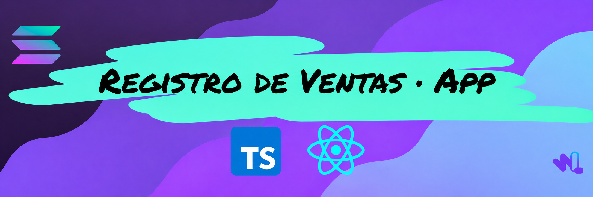

# Registro de Ventas · App



Frontend educativo desarrollado con **TypeScript y React** para interactuar con el programa [Registro de Ventas con PDAs](https://github.com/WayLearnLatam/Registro-Ventas-Solana-PDA) en **Solana Devnet**.

Forma parte del **Solana Engineering Track: Advanced** de WayLearn. Aquí conectamos lo aprendido sobre cuentas, instrucciones y PDAs con una aplicación que se utiliza desde el navegador.

Puedes comenzar haciendo **Fork** de este repositorio. Hemos preparado un entorno de **GitHub Codespaces** para que puedas concentrarte en los ejercicios sin instalar las herramientas del frontend en tu computadora. 🚀

> 📖 Sigue las explicaciones y actividades en el [GitBook de Advanced](https://waylearn.gitbook.io/solana-engineering-track-advanced).

## ¿Qué puedes hacer con la app?

- Conectar una wallet y consultar saldos de Devnet.
- Consultar un registro de ventas, sus clientes y las ventas activas de cada uno.
- Crear un negocio y dar de alta a sus clientes.
- Registrar ventas, corregir su importe y realizar devoluciones.
- Revisar solicitudes de firma, confirmaciones y errores de las transacciones.

El recorrido del proyecto sigue esta relación:

**Registro del negocio → Clientes → Ventas**

Cada entidad tiene su propia cuenta. El frontend deriva sus direcciones y utiliza el cliente generado a partir del IDL para leer datos y construir instrucciones.

> ℹ️ El importe de una venta es un dato del ejercicio: **no cobra ni transfiere SOL o tokens**. La devolución elimina la venta del historial activo y cierra su cuenta; no realiza un reembolso comercial.

## Antes de comenzar

Necesitas una cuenta de GitHub y, para las operaciones que requieren firma, una wallet de navegador compatible con Solana y SOL de prueba en **Devnet**.

Es recomendable tener conocimientos básicos de JavaScript o TypeScript y haber revisado el modelo de cuentas del [programa base](https://github.com/WayLearnLatam/Registro-Ventas-Solana-PDA).

**No necesitas la Solana CLI para ejecutar este frontend.** Puedes trabajar con el programa desplegado desde Solana Playground.

## Comenzar con Codespaces

### 1. Crea tu copia

Haz clic en **Fork**, en la parte superior de este repositorio, para crear una copia en tu cuenta. Así podrás guardar tus cambios y continuar con tu proyecto.

### 2. Abre el entorno

Desde tu copia, selecciona **Code → Codespaces → Create codespace on main**.

Espera a que termine la preparación. El contenedor incluye Node 22 y ejecuta automáticamente la instalación de dependencias y la generación del cliente.

### 3. Inicia la app

En la terminal de Codespaces ejecuta:

```bash
npm run dev
```

### 4. Ábrela en tu navegador

En la pestaña **Ports / Puertos**, localiza el **5173** y selecciona **Open in Browser**.

Abre la aplicación en una pestaña normal del navegador donde tienes instalada tu wallet. La vista incrustada del editor puede no detectar la extensión. El puerto puede permanecer privado; utiliza la misma cuenta de GitHub para acceder.

> 💡 Al terminar, detén el Codespace desde el menú de Codespaces para evitar consumir tiempo de cómputo mientras no lo utilizas.

## Ejecutar en tu computadora

Si prefieres trabajar en local, utiliza **Node.js 22.12 o superior de la rama 22** y npm. Clona tu fork o utiliza directamente el repositorio original:

```bash
git clone https://github.com/WayLearnLatam/Registro-Ventas-Solana-App.git
cd Registro-Ventas-Solana-App
npm ci
npm run cliente
npm run dev
```

Abre `http://localhost:5173` en el navegador con tu wallet instalada.

En Windows puedes ejecutar estos comandos desde WSL. El repositorio también incluye una configuración de Dev Container para VS Code, si ya utilizas Docker y la extensión Dev Containers.

## Conectar el programa de Solana

El frontend y el programa son dos partes del mismo proyecto:

| Parte | Responsabilidad |
| --- | --- |
| [Programa Rust + Anchor](https://github.com/WayLearnLatam/Registro-Ventas-Solana-PDA) | Define las cuentas, ejecuta instrucciones y valida permisos. |
| Este frontend | Lee cuentas, construye instrucciones y solicita a la wallet que firme las transacciones. |
| IDL y cliente generado | Describen la interfaz del programa y permiten utilizarla desde TypeScript. |

### Si aparece «programa de referencia»

El repositorio incluye un **IDL de referencia** para estudiar la estructura y generar el cliente. Con esa configuración puedes conectar tu wallet y consultar saldos; la consulta del registro y sus operaciones permanecen bloqueadas hasta importar el IDL del despliegue que utilizarás.

Si la versión de clase ya viene configurada para el programa correspondiente, puedes continuar con las actividades sin repetir este paso.

### Importar tu IDL

Exporta desde Playground el IDL del programa que realmente compilaste y desplegaste en **Devnet**. Coloca el JSON dentro de tu espacio de trabajo, por ejemplo en `tmp-idl/registro.json`, y ejecuta desde la raíz:

```bash
npm run configurar:idl -- ./tmp-idl/registro.json
```

Si el archivo no incluye la dirección del programa, agrega su Program ID público:

```bash
npm run configurar:idl -- ./tmp-idl/registro.json --program-id TU_PROGRAM_ID
```

El comando comprueba la estructura esperada, importa el IDL y regenera el cliente. Detén el servidor con `Ctrl+C` y vuelve a ejecutar `npm run dev` después de la importación.

**No edites manualmente el cliente generado.** Si cambias el IDL, ejecuta `npm run cliente`. Conserva juntos en tu repositorio `idl.json`, `src/config/programa.json` y `clients/js/`.

> 🔎 La wallet de Playground y la del navegador pueden ser distintas. Como la autoridad participa en la PDA, lo más sencillo es crear un negocio nuevo desde la app con la wallet del navegador. No necesitas trasladar claves privadas entre entornos.

Consulta la [guía de IDL y Playground](./docs/IDL-Y-PLAYGROUND.md) si necesitas revisar la configuración.

## Seguir las sesiones

El proyecto utiliza el mismo frontend durante ambos días. Puedes elegir el punto de partida con estos comandos:

| Comando | Qué prepara |
| --- | --- |
| `npm run clase:dia3` | Pantalla de conexión para explorar wallet, RPC, saldos e IDL. Reserva Registro para el día siguiente. |
| `npm run clase:dia4` | Pantalla del registro con dos funciones por completar: `crearCliente` y `registrarVenta`. |
| `npm run clase:resuelto` | Las cinco operaciones implementadas, como referencia para estudiar y contrastar. |

Detén `npm run dev` antes de cambiar de modo y vuelve a iniciarlo al terminar.

> **Guarda tu avance antes de cambiar de modo.** Estos comandos reemplazan `src/solana/acciones.ts`. Los cambios anteriores se respaldan en `.aula/respaldos/`; el IDL y el cliente generado se conservan. Puedes consultar la solución en `materiales/acciones-resuelto.ts.txt` sin reemplazar tu archivo.

## ¿Dónde está cada cosa?

| Ruta | Qué encontrarás |
| --- | --- |
| `src/components/` | Pantallas y formularios de la aplicación. |
| `src/solana/acciones.ts` | Funciones que conectan los formularios con las instrucciones del programa. |
| `src/solana/lecturas.ts` | Lectura de Registro, Cliente y Venta. |
| `src/solana/pdas.ts` y `seeds.ts` | Derivación de las direcciones de las cuentas. |
| `src/solana/tx.ts` | Preparación, envío, confirmación y errores de las transacciones. |
| `src/config/interfaz.ts` | Título y valores iniciales para personalizar la demo. |
| `idl.json` | IDL utilizado para generar el cliente del programa. |
| `clients/js/src/generated/` | Código generado con Codama; no se modifica a mano. |
| `materiales/` | Versión de ejercicio y solución de las operaciones. |
| `docs/` | Guías de configuración, pruebas y alcance del ejemplo. |

La base utiliza **React + Vite**, **TypeScript**, **Wallet Adapter**, **Solana Kit**, **web3.js** y **Codama**. La integración entre las librerías ya está preparada para que puedas concentrarte en el flujo de cuentas e instrucciones.

## Probar tus cambios

```bash
npm run verificar
```

Este comando comprueba TypeScript, ejecuta las pruebas automatizadas y genera el build del frontend. Las pruebas automatizadas **no envían transacciones**: completa también el recorrido de [pruebas manuales en Devnet](./docs/PRUEBAS-MANUALES.md).

Para tu primera prueba, crea un negocio, agrega un cliente, registra una venta y consulta el resultado. Después prueba corregir el importe, devolver la venta y cancelar una solicitud de firma.

## Si algo no funciona

| Situación | Qué revisar |
| --- | --- |
| La wallet no aparece | Abre la app en una pestaña normal del navegador con una extensión compatible instalada. |
| Falta SOL de prueba | Solicítalo en [Solana Faucet](https://faucet.solana.com/), seleccionando Devnet. |
| No aparece tu negocio | Comprueba el nombre exacto y la dirección de su autoridad; ambos participan en la PDA. |
| No puedes repetir un SKU | Cada cliente solo puede tener una venta activa con ese SKU. |
| El RPC responde con un límite de uso | Espera y vuelve a intentar, o configura otro endpoint de Devnet en `.env.local` siguiendo `.env.example`. |
| Cambiaste el IDL y falla la comprobación | Ejecuta `npm run cliente` y reinicia el servidor. |

## Recursos y comunidad

- [GitBook de Solana Engineering Track: Advanced](https://waylearn.gitbook.io/solana-engineering-track-advanced).
- [Programa Registro de Ventas con PDAs](https://github.com/WayLearnLatam/Registro-Ventas-Solana-PDA).
- [Solana Playground](https://beta.solpg.io/).
- [Comunidad de WayLearn en Discord](https://discord.gg/hvnpbZxu9b).

Este es un proyecto educativo para **Devnet**. Las validaciones del formulario no sustituyen las restricciones del programa. Revisa [seguridad y alcance](./docs/SEGURIDAD-Y-ALCANCE.md) para conocer los límites del ejemplo y los aspectos que deben revisarse antes de producción.
